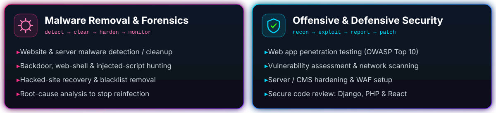

<!-- ═══════════════════════════ HERO ═══════════════════════════ -->

  

  

  
  
  
  
  

<!-- ═══════════════════════════ ABOUT ═══════════════════════════ -->
## ⚡ About Me

<table>
<tr>
<td width="52%" valign="top">

I'm a **security-first developer** from 🇧🇩 **Bangladesh**, bridging robust **backend architecture** with modern **frontend experiences**. With a Computer Science foundation and a passion for **ethical hacking**, I build applications that are not only functional — but **secure by design**.

🏢 &nbsp;**Lead Developer** at **Developers Thrill** 
🔭 &nbsp;Scalable APIs with **Django** · Interactive UIs with **React** 
🦠 &nbsp;Cleaning **hacked websites** & **removing malware** 
🛡️ &nbsp;**Web Security**, **Forensics** & **Machine Learning** 
💬 &nbsp;Ask me about **React ↔ Django**, **Pentesting**, **Tailwind** 
⚡ &nbsp;I treat code like a puzzle — always hunting the most efficient *(and secure)* piece

</td>
<td width="48%" valign="top" align="center">
  
</td>
</tr>
</table>

<!-- ═══════════════════════════ TECH STACK ═══════════════════════════ -->
## 🧰 Tech Stack

| ⚙️ Backend | 🎨 Frontend | 🔧 Tools |
| :---: | :---: | :---: |
|  |  |  |

### 🛡️ Cybersecurity Arsenal

  

  
  
  
  
  
  
   
  
  
  
  
  
  

  

<!-- ═══════════════════════════ PROJECTS ═══════════════════════════ -->
## 🚀 Featured Projects

  
  
  
  

<!-- ═══════════════════════════ STATS ═══════════════════════════ -->
## 📊 GitHub Analytics

  
  

  

  <picture>
    <source media="(prefers-color-scheme: dark)" srcset="https://raw.githubusercontent.com/mdalamin-py/mdalamin-py/output/snake.svg" />
    <source media="(prefers-color-scheme: light)" srcset="https://raw.githubusercontent.com/mdalamin-py/mdalamin-py/output/snake-light.svg" />
    
  </picture>

<!-- ═══════════════════════════ CONTACT ═══════════════════════════ -->
## 🤝 Let's Build Something Secure

  Open to <b>collaborations</b>, <b>freelance projects</b>, <b>malware cleanup</b> & <b>security audits</b>.  
  
  

<!-- ═══════════════════════════ FOOTER ═══════════════════════════ -->

  

